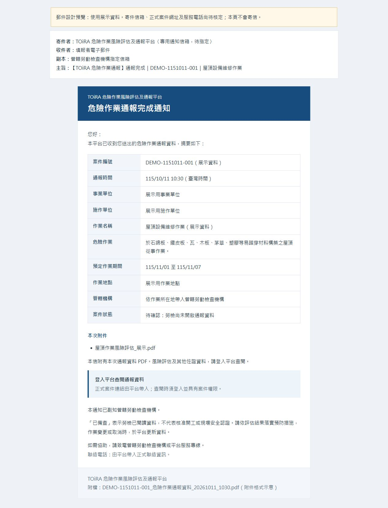

# 資訊公司建置需求：通報完成通知郵件

交付日期：民國 115 年 10 月 11 日。

**請資訊公司於正式平台建置時納入此功能。**本目錄交付的是需求說明及郵件範本，尚未實作寄送服務；本次未修改主系統畫面、通報流程或公開 Q&A。

## 已確認需求

1. 平台成功收到危險作業通報後，寄送通報完成通知。
2. 收件者（To）為填報者電子郵件；副本（Cc）為該案件管轄勞動檢查機構的指定信箱。
3. 通知須清楚列出案件編號及通報摘要，使填報者與管轄機構能辨識案件。
4. 實際郵件由後端服務寄送。GitHub Pages 展示原型不提供正式寄信功能。

## 交付內容

- [寄送規格、純文字範本及 Q32 草稿](specification.md)
- [HTML 郵件版型原始檔](notification-preview.html)：可下載後以瀏覽器查看。
- [完整郵件預覽圖](notification-preview.png)

版型使用展示案件及待指定欄位，不能當作正式通報完成證明。Q32 保留為草稿，寄件設定及正式功能完成後再定稿登錄。

## 建議實作內容

- 依範本產生 HTML 與純文字信件，並附上當次送出版本的通報資料 PDF。
- 原始風險評估及其他佐證檔案保留於平台，提供須登入並具有案件權限的查閱入口。
- 管轄機構收件信箱由管理功能維護；以寄信當下的管轄機構為準，留存實際收件人。
- 記錄各版本通知的寄送時間、結果與退信資訊，處理寄送失敗及重試，避免要求使用者因通知失敗而重複通報。
- 變更與取消通知可沿用規格中的主旨及版本設計，辦理時機另行確認。

## 尚待核定

正式寄件信箱、Reply-To、服務電話、案件網址、PDF 產製內容、郵件附件容量及寄送失敗處理規則，須由職安署與資訊公司確認。`toira-notify` 僅為候選帳號名稱，尚未建立、核定或確認可使用。

## 建置驗收重點

- 測試案件成功收件後，測試填報者及管轄機構均收到對應案件通知。
- 主旨、通報摘要及 PDF 對應同一送出版本；各項勾選作業採完整名稱。
- 未經授權者無法透過案件連結取得通報資料或附件。
- 寄送失敗可追蹤、重試；不會造成案件重複建立。
- 郵件寄出與勞檢閱讀狀態分別記錄，不因寄出郵件就標示「已備查」。

上述驗收供資訊公司建置後執行；目前尚未完成正式寄信驗收，也未寄送任何測試或正式郵件。
